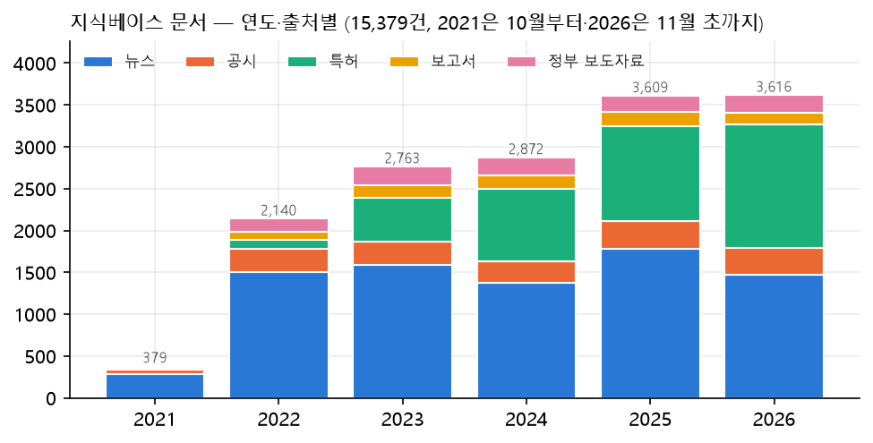
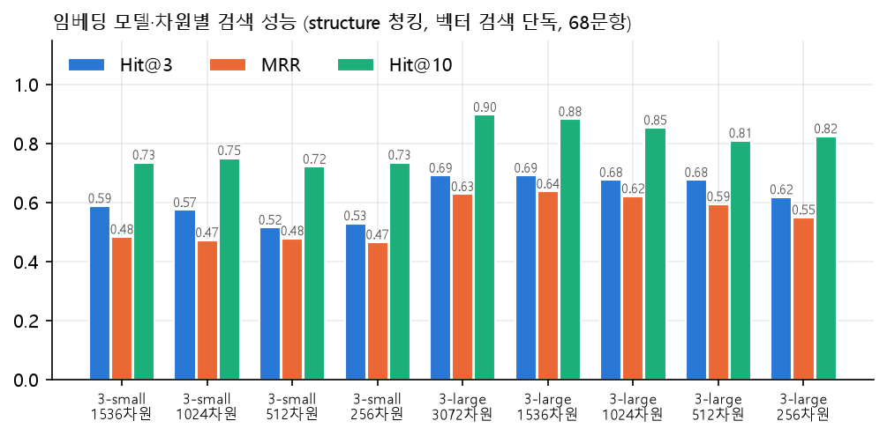
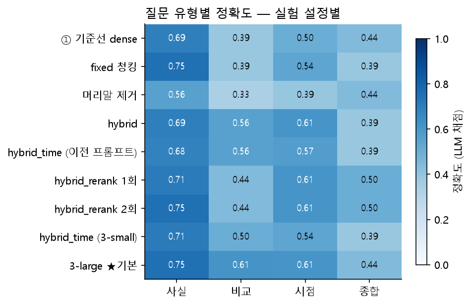
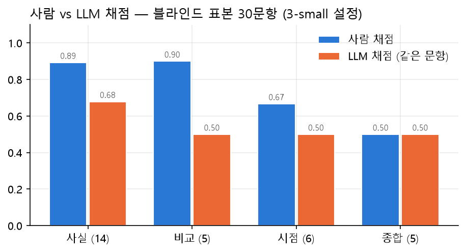
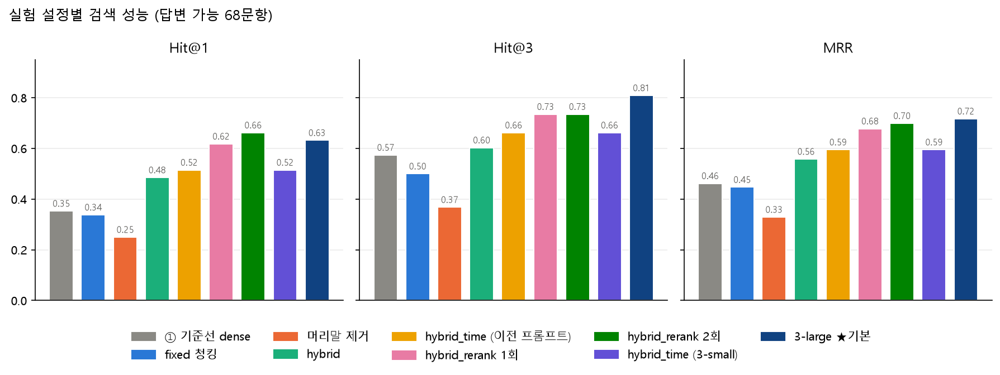
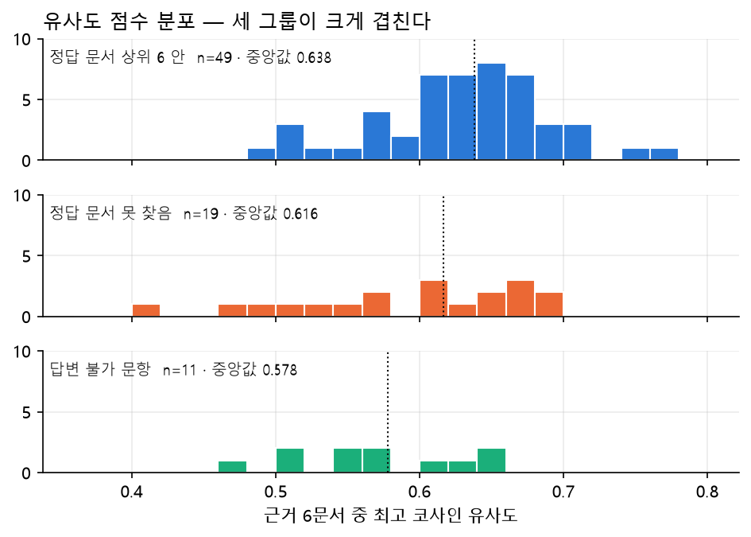
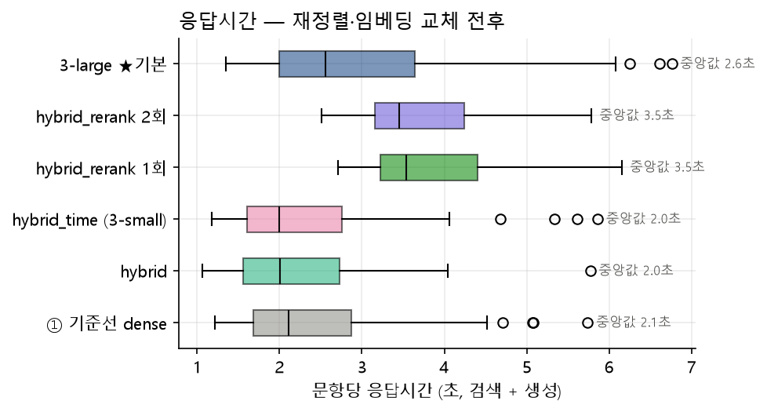
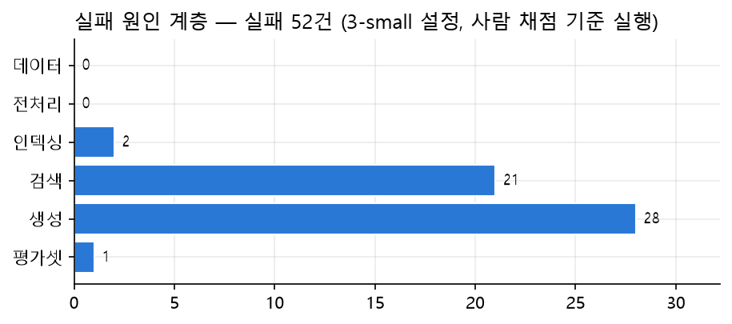

# 바이오·헬스케어 산업·기술 동향 RAG — 최종 리포트

> 주제 B. 산업·기술 동향 · 선택 산업: 바이오·헬스케어 · 작성일 2026-11-10
> 저장소: `mini_proj3/` · 브랜치 `feature/collector`
> 이 리포트의 수치는 모두 `eval/results/`의 실행 결과나 `store/` 집계에서 옮겼다. 재현 명령은 [부록 A](#부록-a-재현-명령)에 있다.

## 요약

| 구분 | 결과 |
|---|---|
| 지식베이스 | 15,379문서 (뉴스 8,001 · 특허 4,109 · 공시 1,516 · 정부 보도자료 1,022 · 산업보고서 731), 청크 57,433개, 2021-10 ~ 2026-11 |
| 직접 수집 | 7,378건 (48%). 1차 자료(공시·정부 보도자료) 2,538건 (16.5%) |
| 평가셋 | 79문항 (사실 36 · 비교 9 · 시점 14 · 종합 9 · 답변 불가 11) |
| 현재 기본 설정 | 청킹 `structure` · 검색 `hybrid_time`(벡터 + BM25 + 질문 연도, RRF) · 임베딩 **`text-embedding-3-large`** (2026-11-10 3-small에서 교체) · 프롬프트 2 · 생성 `gpt-5.4-mini` |
| 검색 개선 | Hit@3 **0.574 → 0.809**, Hit@1 0.353 → 0.632, MRR 0.462 → 0.717 (기준선 → 현재 기본). 단계별: 하이브리드+연도 0.662 → 임베딩 3-large 0.809 |
| 답변 정확도 | LLM 채점 0.581 → **0.662**. 사람 채점(블라인드 표본 30문항, 교체 전 3-small 설정) **0.783** (같은 문항 LLM 0.583) |
| 근거·거절 | 근거 충실도 0.934, 존재하지 않는 인용 번호 0건, 거절 정확도 0.818 (평가셋 오류 1건 제외 시 9/10), 과잉 거절 **0** |
| 가장 약한 유형 | **종합** — 사람·LLM 모두 0.5, 임베딩 교체 후에도 Hit@3 0.333. 3-small에서 사람 기준 0점 3건(F08·T04·T12)은 모두 검색 계층 실패 → 3-large에서 F08 정답, T12 부분 정답, T04는 생성 실패로 이동 |
| 임베딩 비교 | 3-large로 바꾸면 같은 hybrid_time에서 Hit@3 0.662 → **0.809**, 정확도(LLM) 0.603 → **0.662**, 과잉 거절 0.044 → 0. 개선분은 전부 순위가 바뀐 문항에서 나옴. **기본값으로 채택(2026-11-10).** 종합 근거 충실도 하락(0.889 → 0.611)은 사람 확인 필요 (§4.3) |
| 제출 점검 | 30항목(리포트 3항목 포함)을 수치 근거로 판정 (`python -m eval.check_submission`) |

---

## 1. 시스템 정의

### 1.1 대상 사용자

| 사용자 | 하는 일 | 챗봇에서 원하는 것 |
|---|---|---|
| **P1 산업 분석가 (주 사용자)** | 섹터 보고서 작성, 기술·시장 동향 모니터링 | 주제별 동향을 **근거와 시점이 붙은 형태**로 정리, 기사 수치와 원출처의 차이 확인 |
| P2 제약·바이오 BD·전략 담당 | 라이선스 후보 탐색, 경쟁사 동향 | 기업별 기술이전·계약 이력, 특허 출원 흐름 |
| P3 투자 심사역 | 투자 검토용 시장·경쟁 분석 | 기사의 시장 전망이 보고서·공시와 맞는지 검증 |
| P4 정책·사업 기획자 | 규제·지원사업 기획 | 규제 변화(의료 AI, 비대면 진료)와 산업 반응의 연결 |

### 1.2 업무 상황

| # | 상황 | 필요한 근거 |
|---|---|---|
| S1 | 주간·월간 동향 브리핑 작성 | 뉴스(현재) + 공시로 사실 확인 |
| S2 | 기술 성숙도 판단 — 뉴스에서 뜨는 기술이 실제로 특허가 쌓이는지 | 뉴스(현재) vs 특허(선행 지표) |
| S3 | 시장 전망 수치 검증 — 기사 속 시장 규모의 출처와 다른 추정치 비교 | 뉴스 vs 보고서(전망), **상충 표시** |
| S4 | 기업·딜 사실 확인 — 기술수출·공급계약의 규모·상대방·시점 | 공시(1차) > 뉴스 |
| S5 | 규제·정책 영향 파악 | 정부 보도자료 원문 + 뉴스 시계열 |

**설계 원칙.** 출처마다 **시간축이 다르다**는 점을 답변에 드러낸다.
- 시간축: 뉴스 = 현재, 특허 = 선행, 보고서 = 전망, 공시·보도자료 = 1차 근거.
- 근거가 엇갈리면 숨기지 않고 출처·기준·시점을 함께 제시한다.
- 범위 밖 질문은 거절한다: 종목 추천, 의학적 판단, 지식베이스 기간 밖 사건.

### 1.3 대표 질문 (17개, `eval/questions.json`)

| 유형 | 예 |
|---|---|
| 동향 요약 (S1) | Q01 최근 1년간 국내 CDMO 업계의 주요 수주·증설 소식을 정리해줘 |
| 뉴스 vs 특허 (S2) | Q04 최근 2년간 ADC 기술수출 뉴스가 늘었는데, 국내 ADC 특허 출원도 같이 늘었어? |
| 뉴스 vs 보고서 (S3) | Q07 글로벌 CDMO 시장 규모 전망이 기사와 보고서에서 어떻게 달라? |
| 기업·딜 확인 (S4) | Q10 리가켐바이오의 최근 기술이전 계약 상대방과 계약 규모는? |
| 규제 영향 (S5) | Q14 미국 생물보안법 논의가 국내 CDMO에 기회라는 기사와 실제 수주 공시를 비교해줘 |
| 거절·한계 | Q15 삼성바이오로직스 주식 지금 사도 돼? · Q16 2027년 1월 FDA 승인 소식 · Q17 ADC 항암제 부작용 |

8개 하위 주제가 모두 한 번 이상 나온다: ADC, CDMO, AI 신약개발, 바이오 투자, 신약 기술수출, 의료 AI 규제, 비대면 진료, 바이오시밀러.

대표 질문은 부족 자료 탐색(§2.2)과 평가셋 작성(§5)의 출발점으로 썼다.

---

## 2. 지식베이스 구성

### 2.1 문서 탐색 (EDA) — `notebooks/eda.ipynb`

**제공 데이터:** 네이버 뉴스 CSV 3종 65,025행 (2021-10-17 ~ 2026-10-16).

| 발견 | 수치 | 대응 |
|---|---|---|
| 묶음 파일 = 두 키워드 파일의 합집합 | 65,025행 → 고유 **32,452건** | 언론사ID+기사ID(oid/aid)로 문서 ID 통일, 수집 키워드 병합 |
| 문서 종류가 **뉴스 한 종류**뿐 | `문서종류` 100% news | 특허·공시·보고서·정부 원문은 직접 수집 |
| 포털 UI 텍스트 혼입 | 9,960건 (31%) | 정규식으로 제거 |
| 짧은 본문·노이즈 제목·연예/스포츠·주제 무관 | 544 · 101 · 66 · 414건 | 제외 (`rejected_docs`에 사유 기록) |
| 주제 편중 | 68%가 8개 하위 주제 어디에도 안 걸림. ADC 759 · 기술수출 539 · AI 신약개발 386건 | 뉴스만으로 부족한 주제는 공시·특허로 보강 |
| 전망 수치 인용 | 뉴스의 22%가 시장 규모·성장률 인용 | 보고서 원출처와 비교할 상충 질문의 재료 |
| 매체 집중 | 106개 매체 중 상위 10개가 52% | 답변에 발행처 표시, 신뢰성 패널에 발행처 수 표시 |
| 본문 길이 | 중앙값 1,104자, 95% 3,028자 | 대부분 1~3청크 |

### 2.2 부족 자료 탐색 — `eval/kb_coverage.py`

- **방법:** 대표 질문마다 출처별 검색식을 정하고, 질문이 요구하는 출처별로 근거 문서 수를 셌다.
- **기준:** 뉴스 5 · 공시 3 · 특허 10 · 보고서 3 · 정책 2건 이상.
- **1차 점검 결과:** 14문항 중 3개가 부족이었다.

| 문항 | 보강 전 | 원인 판단 | 보강 후 |
|---|---|---|---|
| Q02 비대면 진료 제도 변화 | 정책 원문 0건 | 기사는 제도를 요약할 뿐, 대상 환자·처방 기준은 원문 필요 → **자료 부족** | 정부 보도자료 15건 → OK |
| Q13 식약처 의료 AI 허가 지침 | 정책 원문 0건 | 지침·법 시행 내용은 식약처 원문 필요 → **자료 부족** | 168건 → OK |
| Q14 생물보안법 vs 실제 수주 | 공시 0건 | 공시에 '생물보안법'이라는 단어가 없음 → **자료가 아니라 검색식 문제** | 출처별 검색식 수정 → 공시 140건 → OK |

- **보강 후:** 대표 질문 14개 모두 OK. 거절 문항 3개는 평가셋의 답변 불가 유형으로 옮겼다.
- **보강하지 않은 영역:** 비대면 진료 이용자 후기(블로그)
  - 이유 1: 블로그 글은 작성자 개인정보가 섞이기 쉽다.
  - 이유 2: 업무 질문은 업계·기관의 공식 입장으로 충족된다.
  - → 이 영역은 답변 불가 문항(U10)으로 썼다. 다만 정책 원문을 보강하면서 근거가 생겨 평가셋 오류가 됐다(§8.4).

### 2.3 직접 수집 대상 — 선정 근거와 소스 탐색

| 출처 | 수집 방식 | 선정 근거 | 결과 |
|---|---|---|---|
| **DART 공시** | OpenDART API (`list.json` → `document.xml`) | 계약 상대방·금액·시점의 **1차 근거**. 뉴스 속 "최대 ○조" 표현을 검증 | 시드 기업 39곳, 1,627건 (투자판단 623 · 공급계약 385 · 사업보고서 187 · 자금조달 158 · 기술이전 105 등) |
| **KIPRIS 특허** | KIPRIS Plus API (공보·대표출원인·패밀리·피인용·해외특허) | 뉴스(현재)와 대비되는 **기술 선행 지표** (S2) | 국내 7,872 + 미국 124 + 유럽 118 = 8,114건 |
| **BioIN 산업보고서** | 게시판 본문 HTML 크롤링 (1초 간격) | 시장 전망 수치의 **원출처** (S3). 첨부 PDF 없이 본문에 요약·수치가 있음 | 1,330건 (전망 서술 753건 `outlook`) |
| **정부 보도자료** | 정책브리핑(korea.kr) 목록·상세 + 본문 첨부(HWPX/PDF) 1개 | 규제·제도의 **원문** (S5). §2.2의 부족 자료 | 목록 2,618 → 관련 1,060 → 1,022건 (복지부 518 · 식약처 293 · 과기정통부 113 · 산업부 98) |

**소스 탐색 과정.** 하위 주제별 시드 기업 → 공시 분류 규칙 → 특허 IPC·초록 검색식 → 보고서 게시판 4곳 순으로 넓혔다.
- KIPRIS는 월 무료 한도가 1,000회다. 그래서 기본값을 '검색만'으로 두었다. 검색 1회에 최대 500건을 받는다.
- 보강 호출(청구항·패밀리·피인용)은 ADC 161건에만 썼다. 이번 달 사용량은 약 770회다.

### 2.4 접근 제약과 대체 방안

| 제약 | 대체 |
|---|---|
| dart.fss.or.kr: robots.txt가 공시 뷰어(`/dsaf001/main.do`) 수집을 금지 | 뷰어를 요청하지 않고 **OpenDART API**의 `document.xml`로 원문을 받음. 뷰어 링크는 출처 표시용으로만 저장 |
| www.kipris.or.kr: `Disallow: /` | 화면 크롤링 없이 **KIPRIS Plus API**만 사용 |
| 한국보건산업진흥원(khidi.or.kr): 브리프 본문이 PDF, `/fileDownload` 금지 | 같은 브리프가 **BioIN에 본문으로 재게시**된 것을 수집 (산업 동향 게시판, 보건산업진흥원 230건) |
| KIET(`/common/file/` 금지) | 직접 수집하지 않음. BioIN 재게시본 활용 |
| 보건복지부(mohw.go.kr): 게시판 대부분 금지 | **정책브리핑(korea.kr)** — 각 부처 보도자료를 전재하는 공식 포털, `User-Agent: *` 허용. 4개 부처를 한 번에 수집 |
| KOTRA 해외시장뉴스 API 신청 필요 | BioIN 재게시본 325건으로 확보해 신청하지 않음 |
| 증권사 리서치 | 접근 제한 → 공개 산업보고서(BioIN)와 기업 IR 성격의 공시(실적전망·사업보고서)로 대체 |

- 받아 둔 robots.txt 10개는 `data/compliance/`에 날짜와 함께 보관했다. 요청은 모두 순차 실행이고, 간격은 API 0.15~0.2초, 웹 1초다.
- 개인정보는 저장 전에 지운다(`storage.scrub_personal`).
  - 공시책임자·담당자 이름과 전화번호 (EDA에서 191건 발견)
  - 보도자료의 담당자 표
- 모든 문서에 URL·발행일·수집 일시가 있다: **43,285/43,285 (100%)**.

### 2.5 최종 문서 구성 (종류·기간)



| 출처 | 수집 | 지식베이스 | 선별 기준 |
|---|---|---|---|
| 뉴스 | 31,192 (품질 선별 후) | **8,001** | 중복 처리 후 22,623 → 사건당 최대 3건 → 분기 층화 + 주제·전망 점수 |
| 특허 | 8,114 | **4,109** | 해외 전부, 시드 기업 출원 전부, 국내는 주제별 할당 |
| 공시 | 1,627 | **1,516** | 수시공시 전부 + 사업보고서는 2024·2025 사업연도 'II. 사업의 내용'만 |
| 정부 보도자료 | 1,022 | **1,022** | 관련성 필터 통과분 전부 |
| 산업보고서 | 1,330 | **731** | 분석 보고서 231건 전부 + 산업 동향 브리프 상위 500건 |
| **합계** | 43,285 | **15,379** | 직접 수집 48% · 1차 자료 16.5% |

- 기간: 2021-10 ~ 2026-11.
- 연도별 문서 수: 2021(10월부터) 379 · 2022 2,140 · 2023 2,763 · 2024 2,872 · 2025 3,609 · 2026(11월 초까지) 3,616.
- 하위 주제(중복 태그): 바이오 투자 2,913 · CDMO 2,375 · 비대면 진료 2,345 · ADC 2,114 · AI 신약개발 2,010 · 의료 AI 규제 1,530 · 바이오시밀러 1,163 · 신약 기술수출 663.

### 2.6 커버리지의 한계

- **최근 연도 쏠림:** 2021년 379건과 2026년 3,616건은 거의 10배 차이다. 시점 조건이 없는 질문은 최근 문서 쪽으로 기운다.
- **증권사 리서치·보고서 PDF 첨부 없음:** 시장 전망 수치가 일부 기관 인용(BioIN·협회)에 몰린다.
- **뉴스 선별 손실:** 중복 처리 후 22,623건 중 8,001건만 넣었다. 선별에서 빠진 기사에만 있는 사실은 답할 수 없다.
- **특허 할당:** 국내 의료 AI 특허는 3,501건 중 600건만, 해외 특허는 242건만 넣었다.
- **주제 불균형:** 신약 기술수출 663건이 가장 적다. 이 주제는 정답 문서를 놓치면 대신할 문서가 적다.
- **비공개 정보 없음:** 이용자 후기, 비공개 계약 조건은 원천적으로 없다 → 답변 불가 영역.

---

## 3. 파이프라인 설계

### 3.1 계층 구조

```
① 수집기 collector/  ──▶  ③ 저장 store/docs.db (원문 43,285 · in_kb 표시)
   제공 CSV 적재·DART·KIPRIS·BioIN·정책브리핑 크롤링, 중복 처리, 지식베이스 선별
② 인덱서 indexer/    ──▶  ③ 저장 store/chroma/ (벡터 57,433) · store/bm25/ · store/chunks/
   파싱·정제 → 청크 중복 제거 → 청킹 → 임베딩(캐시) → 적재·검증
④ 챗봇 rag/ + app/   ◀──  ③ 읽기 전용 (질의 임베딩만 생성)
   retriever(벡터+BM25+연도 → RRF) → prompts → chain(LLM) → Streamlit (검색·대화·성능 분석 탭)
   평가 하네스 eval/run_eval.py도 같은 rag.chain.ask를 호출
```

| 계층 | 실행 | 금지 사항 | 검증 (`python -m eval.check_layers`) |
|---|---|---|---|
| ① 수집기 | 배치 | 차트·UI 코드 | 파일 11개, UI 라이브러리 import 0건 |
| ② 인덱서 | 배치 | — | 파일 7개 |
| ③ 저장 | 상시 | — | Chroma `PersistentClient` 3.02GB. 디스크에서 다시 열어 57,433개 확인 |
| ④ 챗봇 | 상시 | 임베딩 생성·크롤링·인덱스 쓰기 | rag 6 + app 4개 파일 정적 위반 0건. **수집기·인덱서 import를 막은 상태에서 실제 앱 구동** — 쓰기 시도 0건, docs.db·Chroma 변경 없음 |

**같은 체인을 쓴다.**
- 평가 하네스는 `rag.chain.ask()`를 부른다.
- 챗봇은 같은 단계를 나눈 `retrieve → stream_answer → finalize`를 부른다. 스트리밍 출력 때문이다.
- 그래서 검색이나 프롬프트를 바꾸면 평가와 챗봇에 똑같이 반영된다.

### 3.2 청크 메타데이터 항목과 선정 근거

| 항목 | 선정 근거 (쓰는 곳) |
|---|---|
| `doc_id`, `chunk_id`, `chunk_index`/`n_chunks` | 원문 조회(docs.db), **평가 정답 매칭**, 문서 단위 중복 제거, 인접 청크 위치 |
| `source_type` (news·disclosure·patent·report·policy) | 출처 종류별 근거 분리 제시, 사이드바 필터, 신뢰도 안내(1차·전망·2차) |
| `evidence_role` (current·leading·outlook) | **시간축 구분** — 현재·선행·전망 근거의 상충 비교 (§1.2 원칙) |
| `title`, `publisher`, `url` | 답변의 출처 표시·링크. 발행처 수(신뢰성 패널) |
| `published_at`, `year`, `quarter` | **시점 질문**: 기간 필터, 질문 연도 검색 목록(`hybrid_time`). Chroma가 문자열 범위 비교에 약해 정수 연도를 따로 둠 |
| `section`, `content_kind` | 사업보고서 헤딩 경로·특허 항목 구분, 표 청크 구분 |
| `topics` | 하위 주제 필터 |
| `is_outlook` | 전망 수치 포함 → 뉴스↔보고서 상충 후보 |
| `event_id` | 같은 사건 뉴스 묶음 → 평가에서 같은 사건 기사를 정답으로 인정, 다양화 |
| `company`, `category` | 기업 필터, 공시 분류·보고서 게시판·특허 국가 |
| `origin`, `char_len`, `config` | 수집 경로, 길이 점검, 청킹 설정 |

- 청크 `text`는 **머리말(제목·발행처·날짜·섹션) + 본문**이다. 검색과 LLM 입력에 쓴다.
- `body`는 머리말을 뺀 본문으로, 인용 표시에 쓴다.
- 머리말을 넣는 근거는 정량 비교에 있다(§4.2): 빼면 Hit@3가 −20.6%p 떨어진다.
- 전수 확인 결과:
  - 청크 57,433개 모두 머리말 1행에 제목, 2행에 발행일이 있다(100%).
  - 필수 메타데이터(doc_id·출처 종류·제목·발행일·URL) 누락은 0건이다.

---

## 4. 문서 처리

### 4.1 중복 처리 — 기준과 처리 전후 건수

**판별 기준** (`collector/dedup_news.py`, 문서 단위)

| 구분 | 판별 기준 | 처리 |
|---|---|---|
| 완전 중복 | URL(oid/aid) 일치 / 정규화한 본문 일치 | 1건만 유지 |
| 재배포본 | 본문 문자 5-gram Jaccard ≥ 0.5 이고 발행 간격 ≤ 3일 (또는 포함도 ≥ 0.8·유사도 ≥ 0.4, 또는 유사도 ≥ 0.8) | 클러스터 대표 1건 (수치가 가장 많은 기사) |
| 동일 사건 | 발행 간격 ≤ 1일 이고 (유사도 ≥ 0.15·제목 겹침 ≥ 0.3) 또는 유사도 ≥ 0.3 | 같은 `event_id`. 내용 동일(포함도 ≥ 0.7·새 수치 없음)이면 축약, **관점이 다르면 유지** (사건당 최대 3건) |
| 수치 보호 | 제외 후보가 대표에 없는 수치를 2개 이상 담음 | 제외하지 않음 |

**임계값 근거.** 후보 쌍 68,688개를 유사도 구간별로 나누고, 구간마다 표본을 직접 읽어 정했다.

| 구간 | 관찰 | 판정 |
|---|---|---|
| ≥ 0.8 | 같은 보도자료를 거의 그대로 전재 | 재배포본 |
| 0.5 ~ 0.8 | 문장 순서·어미만 바꾼 재작성 | 재배포본 |
| 0.3 ~ 0.5 | 같은 발표에 배경·반응을 덧붙인 기사 | 동일 사건 |

- **기간 조건:** 유사도 ≥ 0.5인데 7일 넘게 떨어진 쌍에는 '같은 회사의 다른 사건'이 섞여 있었다. 그래서 재배포본은 3일 이내로 제한했다.
- **수치 보호 기준을 1개 → 2개로 올림:**
  - 1개 기준에서는 단위 환산 차이만으로 재배포본이 남았다(예: 1.1억 달러 / 1,550억 원).
  - 2개로 올리자 남는 재배포본이 612건 → 185건으로 줄었다.

**처리 전후 건수**

```
65,025행 ─URL 병합→ 32,452 ─본문 완전 중복 −118→ 32,334 ─품질 선별→ 31,192
        ─재배포본 −7,677 (3,106 클러스터)→ 23,515 ─동일 사건 축약 −892→ 22,623 (−27.5%)
        ─사건당 3건→ 21,578 ─분기 층화·점수 선별→ 지식베이스 8,001
```

- 관점이 다른 기사가 2건 이상 남은 사건은 1,980개다. 상충 제시 재료로 남긴 것이다.
- 하위 주제별 유지율은 74~83%로 고르다.
- **청크 단위 중복** (`indexer/dedup.py`): 완전 동일 청크 1,362, 반복 상용구 151, 너무 짧음 17개를 제외했다.
  - 청크가 전부 다른 문서와 같아 통째로 빠진 문서가 24건이다(정정 전후 공시, 특허 패밀리 등).
  - 이 문서들은 내용을 남긴 문서를 정답으로 인정하는 별칭(`doc_alias`)으로 처리했다.

### 4.2 청킹 전략 — 정량 비교에 근거한 선택

**세 설정을 같은 임베딩으로 적재해 평가셋 68문항으로 비교했다.**

| 설정 | 분할 | 머리말 |
|---|---|---|
| `fixed` | 모든 문서 800자 창, 100자 겹침, 창 끝 20% 안 문장 경계 | 제목·출처·날짜 |
| **`structure`** | 문서 종류별: 뉴스 문장 600자 · 정책 500자 · 보고서 헤딩 섹션 900자 · 공시 표 행 1,000자(행을 자르지 않음) · 특허 서지·요약/청구항 | 제목·출처·날짜·섹션 |
| `structure_notitle` | structure와 같음 | **없음** (제목 효과 측정용) |

| 설정 | 청크 | Hit@1 | **Hit@3** | Hit@10 | MRR | 사실 | 비교 | 시점 | 종합 |
|---|---|---|---|---|---|---|---|---|---|
| fixed | 47,662 | 0.353 | 0.515 | 0.691 | 0.464 | 0.611 | 0.667 | 0.429 | 0.111 |
| **structure** | 57,433 | **0.353** | **0.588** | **0.735** | **0.483** | **0.694** | 0.667 | **0.571** | 0.111 |
| structure_notitle | 57,433 | 0.250 | 0.382 | 0.618 | 0.354 | 0.472 | 0.222 | 0.286 | 0.333 |

검색 단독 평가(`eval/retrieval_eval.py`, 전체 행렬 곱). 유형별 칸은 Hit@3다.

- 챗봇 체인 전체(검색 + 생성 + 채점)로 다시 재도 순위가 같다(evaluation.md §5).
  - Hit@3: structure 0.574 > fixed 0.500 > notitle 0.368
  - 정확도: 0.588 · 0.610 · 0.478
- 정확도는 fixed가 0.022 높다. 하지만 같은 설정을 반복 측정하면 정확도가 최대 ±0.05 흔들린다(§6.4). 그래서 이 차이로는 판단하지 않았다.

**선택: `structure`**
1. **순위 지표가 모두 가장 높다.** Hit@3는 fixed보다 +7.3%p(엄격 기준 +4.4%p) 높다. 특히 시점 +14%p, 사실 +8%p에서 차이가 난다.
   - 공시 표 행을 자르지 않아 금액·날짜가 한 청크에 남는다.
   - 섹션 경로가 머리말에 들어가 문맥이 보존된다.
2. **머리말 효과가 가장 크다.** 머리말을 빼면 Hit@3이 −20.6%p 떨어진다. 공시·특허는 본문만으로는 어느 회사의 어떤 계약인지 알 수 없기 때문이다.
3. **비용 차이가 작다.** 청크는 20% 많지만 임베딩 비용 차이는 1회 $0.1 미만이다. 문항당 생성 입력 토큰은 오히려 14% 적다(4,597 vs 5,370).

### 4.3 임베딩 선택 근거

**처음 결정 (2026-11-04): `text-embedding-3-small` (1536차원, 코사인).** 그때 근거는 비용·시간이었다.

| 후보 | 판단 근거 |
|---|---|
| text-embedding-3-small | 실측 임베딩 약 30~40분·$0.68 (청크 57,433개, 3,400만 토큰). GPU 불필요 |
| text-embedding-3-large | 단가 6.5배, 벡터 2배. "실패 원인이 표 형식·시점·고유명사라 모델 교체로는 해결되지 않을 것"이라 보고 비교를 미룸 |
| bge-m3 / multilingual-e5 (로컬) | 이 PC에는 GPU가 없음. CPU로 청크 4.7만~5.7만 개 × 청킹 설정 3개면 수 시간 → 일정상 제외 |

그 판단을 **정량으로 검증**하려고 3-large로 같은 청크 57,433개를 임베딩해 비교했다(2026-11-10).
- 청킹(structure)·평가셋·정답 판정은 같고, 모델·차원만 바꾼 단일 변수 비교다.
- 3-large 임베딩은 39분 걸렸고, 비용은 $4.42다(3,400만 토큰 × $0.13/100만).
- 검색 순위만 쟀다(생성·채점 없음).
- 재현: `python -m eval.embedding_comparison`, `--chain`.



**(1) 벡터 검색 단독** (전체 행렬 곱, 답변 가능 68문항)

| 모델 · 차원 | Hit@1 | Hit@3 | Hit@5 | Hit@10 | MRR | 벡터 저장 | 임베딩 비용 |
|---|---|---|---|---|---|---|---|
| 3-small · 1536 (교체 전) | 0.353 | 0.588 | 0.647 | 0.735 | 0.483 | 353MB | $0.68 |
| 3-small · 1024 | 0.338 | 0.574 | 0.632 | 0.750 | 0.472 | 235MB | $0.68 |
| 3-small · 512 | 0.368 | 0.515 | 0.603 | 0.721 | 0.478 | 118MB | $0.68 |
| 3-small · 256 | 0.353 | 0.529 | 0.647 | 0.735 | 0.465 | 59MB | $0.68 |
| **3-large · 3072** | 0.515 | **0.691** | **0.765** | **0.897** | 0.628 | 706MB | $4.42 |
| **3-large · 1536** | **0.529** | **0.691** | 0.750 | 0.882 | **0.637** | 353MB | $4.42 |
| 3-large · 1024 | 0.529 | 0.676 | 0.735 | 0.853 | 0.621 | 235MB | $4.42 |
| 3-large · 512 | 0.471 | 0.676 | 0.750 | 0.809 | 0.594 | 118MB | $4.42 |
| 3-large · 256 | 0.412 | 0.618 | 0.779 | 0.824 | 0.549 | 59MB | $4.42 |

- 차원 축소는 text-embedding-3 계열의 앞쪽 차원을 잘라 다시 정규화한 것이다. API의 `dimensions` 옵션과 같은 방식이라 추가 비용 없이 쟀다.

**(2) 챗봇 검색기 기준** (`rag.retriever.search`, Chroma, 상위 6문서)

| 모델 \ 검색 방식 | dense Hit@3 / MRR | hybrid Hit@3 / MRR | **hybrid_time** Hit@1 / Hit@3 / Hit@6 / MRR |
|---|---|---|---|
| 3-small (교체 전) | 0.574 / 0.462 | 0.603 / 0.558 | 0.515 / 0.662 / 0.721 / 0.595 |
| **3-large** | 0.691 / 0.625 | 0.721 / 0.661 | **0.632 / 0.809 / 0.853 / 0.717** |

| hybrid_time 유형별 Hit@3 | 사실 (36) | 비교 (9) | 시점 (14) | 종합 (9) |
|---|---|---|---|---|
| 3-small | 0.778 | 0.667 | 0.571 | 0.333 |
| 3-large | **0.917** | **0.778** | **0.857** | 0.333 |

- **측정 확인:** 3-small 행은 평가 하네스의 값(0.574 · 0.603 · 0.662)을 그대로 재현했다.
- **3-large가 Hit@3로 새로 맞힌 문항 11개 · 잃은 문항 1개(F23).**
  - 새로 맞힌 문항: F04 F05 F08 F13 F15 F17 C02 T01 T02 T04 T08
  - 사람 기준 0점이던 **F08(6위 밖 → 1위)·T04(→ 2위)** 가 포함된다. T12도 6위 밖 → 4위로 근거 6개 안에 들어온다.
  - 연도별 공시 혼동 4건(F13·T01·T02·T04)과 표현 불일치(F17)도 풀렸다. 앞서 '질의 쪽을 바꿔야 한다'고 본 실패들이다.
- **종합 질문은 그대로다(0.333).** 종합 질문의 약점은 임베딩이 아니라 질의 하나로 검색하는 구조의 문제다(§8.3).
- 3-large를 1536차원으로 줄여도 Hit@3는 같고(0.691) 저장 용량은 현재와 같다(353MB). 3-small은 차원을 줄이면 Hit@3가 바로 떨어진다(1024: 0.574, 512: 0.515).

**(3) 생성·채점까지 재측정** — 임베딩 모델만 바꾸고 나머지는 고정했다.
- 고정한 것: 검색 hybrid_time, 프롬프트 2, 생성 `gpt-5.4-mini`, 채점 `gpt-5.4`, 79문항
- 결과 파일: `answer_eval_structure__3large__hybrid_time__gpt-5.4-mini_prompt2.json`

| 지표 (답변 가능 68) | 3-small (교체 전) | **3-large (현재 기본)** | 변화 |
|---|---|---|---|
| Hit@1 / Hit@3 / MRR | 0.515 / 0.662 / 0.595 | **0.632 / 0.809 / 0.717** | +11.7%p / +14.7%p / +0.122 |
| 인용 정답률 | 0.721 | **0.838** | +11.7%p |
| 정확도 (LLM 채점) | 0.603 | **0.662** | +0.059 |
| correct / partial / wrong / 과잉 거절 | 21 / 40 / 4 / 3 | **26** / 38 / 4 / **0** | |
| 근거 충실도 | 0.923 | 0.934 | +0.011 |
| 종합 근거 충실도 | 0.889 | **0.611** | −0.278 |
| 거절 정확도 | 0.818 | 0.818 | 0 |
| 지연 중앙값 | 2.0초 | 2.56초 | +0.56초 |

| 유형별 정확도 | 사실 (36) | 비교 (9) | 시점 (14) | 종합 (9) |
|---|---|---|---|---|
| 3-small | 0.708 | 0.500 | 0.536 | 0.389 |
| 3-large | **0.750** | **0.611** | **0.607** | **0.444** |

- **개선의 원인이 검색임이 분리된다.**
  - 정답 문서 순위가 바뀐 20문항: 정확도 0.475 → **0.675**
  - 순위가 같은 48문항: 0.656 → 0.656, **변화 0**. 실행 간 생성·채점 잡음(최대 ±0.05)이 서로 상쇄됐다.
  - 따라서 전체 +0.059는 측정 잡음과 비슷한 크기지만, 원인이 검색 순위 개선 한 가지로 설명된다.
- **문항 단위:** 오른 문항 14 · 내린 문항 8.
  - 사람 기준 0점이던 **F08은 0 → 1**(6위 밖 → 1위), T12는 0 → 0.5(→ 4위), F17·T01은 0·0.5 → 1이다.
  - 내린 8개 중 5개(F02·F10·F20·F25·T09)는 두 실행 모두 정답 문서가 1위다. 즉 생성·채점의 흔들림이다.
  - F10은 실제 오답이다. 다른 공시(탁소텔 인수)의 금액을 답했다.
- **T04는 실패 계층이 바뀌었다.** 정답 문서가 2위로 들어왔는데도 여전히 도급계약 금액으로 답했다. 이제는 **비슷한 공시를 구분하지 못하는 생성 실패**다(§8.2).
- **종합 근거 충실도 하락(0.889 → 0.611)은 위험 신호다.** 재정렬에서 본 것과 같은 방향이다.
  - 9문항 중 4문항이 내렸다: S03·S06·S07은 1 → 0.5, S08은 1 → 0.
  - S03은 근거에 없는 해석('기술적 제약·공급망 부담')을 덧붙였다. 이것은 실제 손실이다.
  - S08은 채점 이유가 '핵심 수치를 제시하지 못함'이다. 정확도 판단이 섞인 것이다.
  - 근거의 출처 종류 수는 평균 1.89로 같다.
  - 9문항 표본이라 사람 확인 전에는 결론을 내리지 않는다.
- **사람 채점 표본 30문항의 LLM 점수:** 0.583 → 0.617. 이 실행은 사람이 채점하지 않았다.

**판단**
1. **처음 결정의 근거는 틀렸다.** "모델을 바꿔도 해결되지 않는다"는 가정은 맞지 않았다.
   - 검색 순위(결정적 지표)가 크게 좋아졌다: Hit@3 +14.7%p, MRR +0.122.
   - 그 효과가 답변까지 이어진다: 순위가 바뀐 문항의 정확도 +0.20, 과잉 거절 0.
   - LLM 재정렬(Hit@3 0.735, 지연 +1.4초)보다 낫고, 지연 증가도 0.56초로 작다.
2. **임베딩을 교체했다 (2026-11-10, 현재 기본).**
   - 코드 기본값을 바꿨다: `rag/retriever.py`의 `EMBED_MODEL`, `indexer/embed.py`의 `DEFAULT_MODEL` → `text-embedding-3-large`. `.env`의 `EMBED_MODEL`로 되돌릴 수 있다.
   - 컬렉션 `structure__text-embedding-3-large`(3072차원)는 적재·검증을 마쳤다. 계층 분리 검증과 제출 점검을 새 기본값으로 다시 돌려 모두 통과했다.
   - 신뢰성 지표 기준값(`rag/reliability.py`)도 새 실행으로 바꿨다. 주의 표시 2개는 3-large 답변에서도 정확도를 갈랐다(§10.2).
   - 실패 계층 판정도 새 실행으로 다시 했다: 실패 52 → 46건, 검색 계층 21 → 11건(§8.1).
   - **남은 확인:** 사람 채점(§6.5)과 §8의 사례 분석은 교체 전 3-small 실행의 결과다. 같은 30문항으로 사람 채점을 반복해 종합 근거 충실도 하락이 실제인지 확인해야 한다.
   - 비용은 다음과 같다.
     - 1회 임베딩: $4.42·39분 (신규 문서는 캐시로 증분)
     - 질의 임베딩: 단가 6.5배. 질의는 짧아 문항당 $0.00001 수준
     - 벡터 저장: 3072차원 706MB. 1536차원으로 줄이면 현재와 같은 353MB이고, 벡터 단독 Hit@3도 같다(0.691)
   - 1536차원 축소는 별도 단일 변수 실험으로 재측정한다. 이번 생성·채점은 3072차원으로 했다.

---

## 5. 평가셋 설계 — `eval/eval_set.jsonl` (79문항)

### 5.1 구성 의도

- **작성 시점:** 챗봇 구현 전에, 지식베이스 문서를 직접 읽고 작성했다.
- **정답 기준(`answer_key`):** 원문의 수치·날짜를 그대로 옮겼다.
- **정답 문서(`gold_doc_ids`):** 지식베이스(`in_kb=1`)에 있는지 확인했다.
- **목적:** 검색(정답 문서 순위)과 생성(정답 기준 대비 답변)을 **따로 진단**할 수 있게 하는 것이다. 실패 원인을 계층별로 나누는 데(§7·§8) 이 분리가 필요하다.
- **정답 확장 (모든 설정에 똑같이 적용):** 아래도 정답으로 인정한다. 엄격 기준 Hit@3도 함께 보고한다.
  - 공시의 [정정]본
  - 같은 사건(`event_id`) 기사
  - 청크 중복으로 내용이 다른 문서에 남은 경우(`doc_alias`)
  - 수치를 직접 확인한 대체 기사(`also_accept`)

### 5.2 유형별 구성

| 유형 | 문항 | 비중 | 검증 대상 | 예 |
|---|---|---|---|---|
| 사실 (`fact`) | 36 | 46% | 기본 검색 정확도 | F05 리가켐바이오-암젠 계약 규모 |
| 비교 (`comparison`) | 9 | 11% | 복수 문서 종합 | C04 삼성바이오로직스 7월 vs 10월 계약 |
| 시점 (`temporal`) | 14 | 18% | 발행일·정정 이력 활용 | T03 2026년 매출 전망 정정 |
| 종합 (`synthesis`) | 9 | 11% | 상충 근거 처리 | S01 생물보안법 기대 vs 실제 수주 |
| 답변 불가 (`unanswerable`) | 11 | 14% | 거절 | U01 2028년 전망, U02 비공개 마일스톤 |

- 정답 출처(중복 포함): 공시 33 · 뉴스 17 · 정부 보도자료 14 · 보고서 7 · 특허 3.
- 상충 문항(C05·C06·S02·S08)은 같은 지표를 출처마다 다르게 제시하는 **실제 사례**로 만들었다. 정답은 '어느 쪽이 맞다'가 아니라 **차이와 기준을 함께 제시**하는 것이다.

### 5.3 답변 불가 유형을 포함한 이유

- 근거가 없을 때 지어내지 않고 멈추는지는 **답변 가능 문항만으로는 측정할 수 없다.** 업무에서 가장 위험한 실패가 '그럴듯한 근거 없는 답'이기 때문이다.
- 실패 양상이 다른 세 종류를 섞었다.
  1. **지식베이스 기간 밖:** 2027·2028년 실적·승인 (U01·U03·U04·U11)
  2. **주제 범위 밖:** 화장품, 의학 조언, 투자 권유 (U05·U07·U08)
  3. **근거 문서는 있지만 질문한 수치가 비공개** (U02). 가장 어려운 유형이다. 관련 문서가 높은 유사도로 검색되기 때문이다.
- 함께 측정하는 것: 과잉 거절(답할 수 있는데 거절)도 같이 잰다. 거절이 늘면 정확도가 떨어지므로 두 지표를 함께 본다.

---

## 6. 평가 결과

### 6.1 측정 체계 — `eval/run_eval.py`

| 구분 | 지표 | 산출 |
|---|---|---|
| 검색 | Hit@1·3·6, MRR | 체인이 생성 모델에 넘긴 문서 6개 안에서 정답 문서의 순위 |
| 인용 | 인용 정답률, 잘못된 번호 | 답변의 `[n]` 인용 중 정답 문서 포함 여부, [근거]에 없는 번호 |
| 거절 | 거절 정확도, 과잉 거절 | 답변 불가 문항이 `[답변 불가]`로 시작하는 비율 / 답변 가능 문항을 거절한 비율 |
| 답변 | 정확도, 근거 충실도, 상충 처리 | LLM 채점(`gpt-5.4`, 생성보다 큰 모델): correct 1 · partial 0.5 · wrong 0 |
| 사람 채점 | 정확도, LLM 일치율, Cohen κ | 블라인드 층화 표본 30문항 (`eval/manual_review.py`) |
| 비용 | 지연, 토큰 | 문항당 지연 중앙값, 입력·출력 토큰 |

### 6.2 기준 설정의 측정값 (2026-11-05)

기준 설정: `structure` 청킹 · 벡터 검색(dense) · 상위 6문서 · 생성 `gpt-5.4-mini` · 프롬프트 1.

| 구분 | 문항 | Hit@1 | Hit@3 | Hit@6 | MRR | 인용 정답률 | 정확도 | 근거 충실도 | 과잉 거절 |
|---|---|---|---|---|---|---|---|---|---|
| 답변 가능 | 68 | 0.353 | 0.574 | 0.647 | 0.462 | 0.647 | 0.581 | 0.929 | 0.074 |
| 사실 | 36 | 0.500 | 0.667 | 0.806 | 0.605 | 0.806 | 0.694 | 0.984 | 0.111 |
| 비교 | 9 | 0.222 | 0.667 | 0.667 | 0.426 | 0.667 | **0.389** | 0.875 | 0.111 |
| 시점 | 14 | 0.286 | 0.571 | 0.571 | 0.393 | 0.571 | 0.500 | 0.857 | 0 |
| 종합 | 9 | 0 | 0.111 | 0.111 | 0.037 | 0.111 | 0.444 | 0.889 | 0 |
| 답변 불가 | 11 | 거절 정확도 0.818 | | | | | | | |

### 6.3 지표별 결과 — 교체 전 기본 설정 (`hybrid_time` + 프롬프트 2 + 임베딩 3-small)

> 현재 기본(임베딩 3-large)의 지표는 §4.3 (3) 표와 §7.3에 있다: Hit@3 0.809 · MRR 0.717 · 정확도(LLM) 0.662 · 근거 충실도 0.934 · 과잉 거절 0 · 지연 2.56초.
> 이 절과 §6.4~§6.5·§8의 상세 분석은 사람 채점을 한 3-small 실행 기준이다.

| 지표 | 값 | 비고 |
|---|---|---|
| Hit@1 / Hit@3 / Hit@6 / MRR | 0.515 / **0.662** / 0.721 / 0.595 | 검색 지표는 같은 설정이면 결정적 |
| 인용 정답률 | 0.721 | |
| 정확도 (LLM 채점) | 0.603 | |
| 정확도 (사람 채점, 표본 30) | **0.783** (같은 문항 LLM 0.583) | §6.5 |
| 근거 충실도 | 0.923 | 근거 밖 주장은 모두 일부 문장 수준(0.5). 전부 지어낸 답변(0)은 없음 |
| 잘못된 인용 번호 | 0건 | 거절하지 않은 답변 67/67이 `[n]` 인용 |
| 상충 처리 (비교·종합) | 0.579 | |
| 거절 정확도 / 과잉 거절 | 0.818 (9/11) / 0.044 | 거절 문구 12/12 정확히 일치 |
| 지연 중앙값 | 2.0초 | 입력 약 5,000 토큰/문항 |

### 6.4 질문 유형별 정확도



| 정확도 (LLM) | 사실 | 비교 | 시점 | 종합 |
|---|---|---|---|---|
| 기준선 dense | 0.694 | **0.389** | 0.500 | 0.444 |
| hybrid | 0.694 | 0.556 | 0.607 | 0.389 |
| hybrid_time ★기본 | 0.708 | 0.500 | 0.536 | **0.389** |
| hybrid_rerank 1·2회 | 0.708 · 0.750 | 0.444 · 0.444 | 0.607 · 0.607 | 0.500 · 0.500 |

- **기준선에서는 비교 유형이 가장 낮았다(0.389).** 복수 문서를 함께 찾아야 하는 유형의 전형적인 패턴이다.
  - 원인: 벡터 검색이 고유명사·제품 코드(SOTIO, ALT-B4)를 구분하지 못해 비교 대상 한쪽을 놓쳤다.
  - BM25를 더하자 0.556으로 올랐다(§7).
- **개선 후에는 종합 유형이 최하위로 남았다(0.389).** 정답 문서가 여럿이고 쟁점이 넓어, 질의 하나로는 근거가 한쪽으로 몰린다.
- **측정 잡음:** 같은 dense 설정을 세 번 돌린 정확도가 0.581 · 0.588 · 0.537이다. 실행 간 차이가 최대 0.05다.
  - 그래서 0.05 미만의 정확도 차이는 설정 차이로 해석하지 않았다.
  - Hit@k는 같은 설정이면 79문항 모두 같다(결정적).
- 비교·종합은 9문항씩이라 1문항이 약 0.11에 해당한다.

### 6.5 사람 채점으로 본 LLM 채점의 신뢰도



- **표본:** 현재 기본 실행의 답변 가능 문항에서 유형별로 층화한 30문항이다(사실 14 · 비교 5 · 시점 6 · 종합 5, 고정 시드). LLM 판정을 가린 채 채점했다.
- **채점 기준(사람 채점자 확정):**
  - `1`: 질문이 묻는 내용을 정확히 답함. 질문이 묻지 않은 세부 조건이 빠져도 1
  - `0.5`: 질문이 묻는 내용 중 일부만 답함
  - `0`: 핵심이 틀림, 또는 근거가 있는데 거절함

| 지표 | 값 |
|---|---|
| 사람 정확도 / 같은 문항 LLM | **0.783** / 0.583 |
| 사람 기준 전체 추정 (유형 가중) | 0.795 (LLM 전체 0.603) |
| 완전 일치 · 0.5점 이내 일치 | 53% · **100%** |
| Cohen κ | 0.308 |
| 사람이 더 높게 / 더 낮게 | **13** / 1 |

- **κ가 낮은 이유는 무작위 불일치가 아니라 채점 기준 차이다.**
  - 불일치 14건 중 13건이 'LLM partial → 사람 1점'이다. 사람 메모 대부분이 "질문에서 직접 요구하지 않음"이다.
  - 0.5점을 넘는 불일치는 없다.
- **해석:** LLM 채점은 **한 방향으로 일관되게 엄격**하다.
  - 그래서 같은 채점자로 잰 실험 간 비교(§7)는 유효하다.
  - 다만 절대 정확도는 사람 기준보다 약 0.2 낮게 읽어야 한다.
- 사람이 더 낮게 준 1건(T04)은 LLM이 놓친 오답이다(§8.2).

### 6.6 시각화 — 성능 분석 탭 (`app/dashboard.py`)

챗봇과 별도 탭으로 구성했다. 원자료는 `eval/results/`와 `docs.db`다.

| 차트 | 표현 대상 | 이 리포트의 그림 |
|---|---|---|
| 설정별 비교 | 실험 설정별 Hit@1·Hit@3·MRR + 기준선 대비 %p 표 | 그림 1 |
| 질문 유형별 | 설정 × 유형 히트맵, 채점 분포, 실패 사례 원문 | 그림 2 |
| 유사도 분포 | 정답 찾음/못 찾음/답변 불가의 최고 유사도 + 임계값 시뮬레이션 | 그림 4 |
| 지식베이스 구성 | 연도·분기 × 출처, 수집 → 선별, 하위 주제 | 그림 5 |
| 응답시간 | 설정별 지연 박스플롯, 중앙값·p90 | 그림 6 |





**유사도 분포 → 임계값 판단**

| 그룹 | 최고 유사도 중앙값 |
|---|---|
| 정답 문서 상위 6 안 | 0.638 |
| 정답 문서 못 찾음 | 0.616 |
| 답변 불가 | 0.578 |

| 임계값 | 답변 불가 차단 | 정상 문항 오차단 (그중 correct·partial) |
|---|---|---|
| 0.50 | 1/11 | 4/68 (3) |
| 0.55 | 3/11 | 11/68 (8) |
| 0.58 | 7/11 | 18/68 (14) |

- 세 그룹이 크게 겹친다. 같은 도메인 안에서는 코사인 유사도가 0.4~0.7에 몰리기 때문이다.
- **결정: 유사도 임계값을 기본 거절 수단으로 쓰지 않는다.**
  - 거절은 프롬프트의 거절 규칙에 맡긴다.
  - 대신 유사도는 답변별 주의 표시로 쓴다(§10.2).



---

## 7. 개선 내역

### 7.1 방법 — 단일 변수 개선 루프

```
측정 → 실패 사례 확인 → 원인 계층 특정 → 단일 변수 변경 → 재측정
```

- 실험마다 바꾼 변수는 하나다.
- 결과는 `eval/results/answer_eval_<태그>.json`으로 저장했다.
- 실험 기록은 `eval/experiments.json`에 있다: 부모 실험, 원인 계층, 바꾼 변수, 결정.

### 7.2 실패 분석 → 변경 → 재측정

| # | 실패 분석 (원인 계층) | 바꾼 변수 하나 | 재측정 | 결정 |
|---|---|---|---|---|
| 1 | 청크에 회사·계약 정보가 없으면 공시·특허를 구분하지 못함 (인덱싱) | 청킹 방식 structure → fixed / 머리말 포함 → 제외 | Hit@3 −7.4%p / −20.6%p | structure + 머리말 유지 |
| 2 | Hit@3 실패 29건 중 고유명사·제품 코드(LCB14, SOTIO, ALT-B4, 코어라인소프트)를 벡터 검색이 구분하지 못함 (검색) | 검색 방식: dense → **dense + BM25 (RRF)** | Hit@1 0.353 → 0.485, Hit@3 0.574 → 0.603, 비교 정확도 0.389 → 0.556 | 채택 후 확장 |
| 3 | "2024년 10월" 질문에 2023년 문서가 1~3위 — 시점 조건 무시 (검색) | **질문 연도로 거른 벡터 목록**을 RRF에 추가 (필터가 아니라 추가 목록) | Hit@3 0.603 → **0.662**, MRR 0.558 → 0.595, 과잉 거절 0.074 → 0.059 | **채택 (기본)** |
| 4 | 정답이 4~6위 (F04·F05·F12) (검색) | LLM 재정렬 (후보 15문서) | Hit@3 0.735 (2회 동일), 종합 근거 충실도 0.94 → 0.6, 지연 +1.4초 | 보류 (§10.1) |
| 5 | 과제 필수 요건 3개가 일부만 반영 (생성) | 시스템 프롬프트 | 정확도 동일(0.603), 거절 문구 12/12, 과잉 거절 0.059 → 0.044, 출처 종류 표기 0 → 61/67 | **채택 (기본)** |
| 6 | F08·F15가 넓은 검색에서는 1위인데 답변 근거 6개에는 없음 (검색) | 후보 청크 수 pool 40 → 80·160·400 (순위만 측정) | Hit@3 0.662 → 0.662·0.647·0.662 (F08·F15 얻고 F21·S04 잃음) | **기각** — 생성 재측정 안 함 |
| 7 | 같은 회사의 비슷한 공시를 구분하지 못함 (검색·인덱싱). 처음 임베딩 결정의 근거가 비용뿐이었음 | 임베딩 모델 3-small → 3-large | Hit@3 0.662 → **0.809**, 정확도 0.603 → **0.662**, 인용 정답률 0.721 → 0.838, 과잉 거절 0.044 → 0, 종합 근거 충실도 0.889 → 0.611, 지연 +0.56초 | **채택 (현재 기본)** — 종합 근거 충실도는 사람 확인 필요 (§4.3) |

추가로, 평가 하네스 자체의 결함도 고쳤다.
- 재정렬 첫 측정에서 근거 충실도가 0.84로 떨어졌다. 원인은 하네스였다: 채점 근거를 **다시 검색해서** 만들고 있었다.
- 재정렬은 비결정적이라 다시 검색하면 근거가 달라진다.
- → 체인이 실제로 LLM에 넘긴 근거(`context`)로 채점하도록 바꿨다.

### 7.3 개선 전후 비교표 (답변 가능 68문항)

| 설정 | Hit@1 | Hit@3 | Hit@6 | MRR | 인용 정답률 | 정확도 (LLM) | 근거 충실도 | 과잉 거절 | 거절 정확도 | 지연 |
|---|---|---|---|---|---|---|---|---|---|---|
| 기준선 (dense, 프롬프트 1) | 0.353 | 0.574 | 0.647 | 0.462 | 0.647 | 0.581 | 0.929 | 0.074 | 0.818 | 2.1초 |
| hybrid | 0.485 | 0.603 | 0.676 | 0.558 | 0.676 | 0.618 | 0.952 | 0.074 | 0.818 | 2.0초 |
| hybrid_time | 0.515 | 0.662 | 0.721 | 0.595 | 0.706 | 0.603 | 0.953 | 0.059 | 0.818 | 2.1초 |
| hybrid_time + 프롬프트 2 | 0.515 | 0.662 | 0.721 | 0.595 | 0.721 | 0.603 | 0.923 | 0.044 | 0.818 | 2.0초 |
| **위 + 임베딩 3-large (현재)** | **0.632** | **0.809** | **0.853** | **0.717** | **0.838** | **0.662** | **0.934** | **0.000** | 0.818 | 2.56초 |
| 변화 (기준선 → 현재) | **+27.9%p** | **+23.5%p** | +20.6%p | **+0.255** | +19.1%p | +0.081 | +0.005 | −7.4%p | 0 | +0.45초 |

| 유형별 MRR | 사실 | 비교 | 시점 | 종합 |
|---|---|---|---|---|
| 기준선 | 0.605 | 0.426 | 0.393 | 0.037 |
| 현재 | **0.738** | **0.611** | **0.502** | **0.148** |

**오답 수로 본 변화** (같은 날 dense 재실행 대비)

| 구분 | dense | hybrid_time |
|---|---|---|
| correct | 16 | **21** |
| wrong (정답 문서 못 찾음) | 11 (8) | **7 (6)** |

- 정확도 변화(+0.022)는 측정 잡음과 비슷한 크기다. 개선은 주로 **순위 지표**와 **오답 수 감소**로 판단한다.
- 사람 채점(현재 설정 0.783)은 기준선에는 하지 않았다. 그래서 사람 기준의 전후 비교는 없다(§9.2).

---

## 8. 실패 사례 분석

> 개선하지 못한 사례를 계층별로 판정하고, 사람 채점으로 판정을 보정했다.
> 원자료: `eval/results/failure_layers__…prompt2.json`, `manual_review__…prompt2.csv`

### 8.1 원인 계층 판정 — `eval/diagnose_failures.py`

- **실패 문항 정의:**
  - 답변 가능 문항: Hit@3 실패이거나 correct가 아닌 문항
  - 답변 불가 문항: 거절하지 않은 문항
- **판정 방법:** 문항마다 증거로 원인 계층 하나를 정했다. 판정 순서는 아래 표 순서다.

| 증상 | 원인 계층 | 판정 증거 |
|---|---|---|
| 정답 문서가 지식베이스에 없음 | 데이터 | 정답(별칭 포함)이 docs.db에 없거나 `in_kb=0` |
| 정답 문서가 있으나 검색되지 않음 | 인덱싱 | 인덱스에 있으나 넓은 검색 상위 60문서에도 없음 |
| 검색은 되었으나 순위가 낮음 | 검색 | 60위 안에는 있으나 답변 근거 상위 3 밖 |
| 근거는 정확하나 답변이 부정확 | 생성 | 정답 문서가 1~3위인데 correct가 아님 |
| 상위가 같은 내용으로 채워짐 | 전처리 (보조) | 상위 6문서 중 같은 내용 쌍 2개 이상 |



| 계층 | 실패 | 문항 |
|---|---|---|
| 데이터 | **0** | 정답 문서는 모두 지식베이스와 인덱스에 있다 |
| 전처리 | **0** | 보조 표시 7건은 같은 양식의 서로 다른 공시(§8.5) |
| 인덱싱 | 2 | C07 · S05 |
| 검색 | 21 | 4~6위 4 · 6위 밖(넓은 검색 7~52위) 17 |
| 생성 | 28 | 답변 부정확 27 · 거절 실패 U08 |
| 평가셋 | 1 | U10 |

**임베딩 교체 후 (현재 기본, 3-large) 재판정:** 실패 52 → **46**건.
- 검색 21 → **11**: F12 F19 F23 C05 T10 S01 S02 S03 S07 T12 S08. 종합 질문이 대부분이다.
- 생성 28 → 32: 정답 문서를 받게 된 문항이 생성 단계로 넘어왔다.
- 인덱싱 2(C07·S05) · 평가셋 1(U10)은 그대로다.
- → 다음 병목은 **생성**(비슷한 공시 구분·종합 쟁점 구성)과 **종합 질문의 검색 구조**다.
- 원자료: `failure_layers__structure__3large__…json`. 아래 사례 분석은 사람 채점을 한 3-small 실행 기준이다.

**사람 채점으로 보정한 결과.** 표본 30문항을 위 판정과 겹쳐 봤다.

| 판정 계층 | 표본 | 사람 1점 (실패 아님) | 사람 기준으로도 실패 |
|---|---|---|---|
| 생성 | 15 | **10** | 5: F30 · C03 · S04 · S06 · S09 |
| 검색 | 9 | 4 (정답 문서가 밀렸어도 다른 근거로 답함) | 5: **F08(0) · T04(0) · T12(0)** · S02 · S07 |

- **생성 계층 실패는 LLM 채점이 부풀렸다.** 사실·시점 문항의 '세부 요소 누락'은 사람 기준으로 6건 중 5건이 정답이다.
- **사람 기준 0점 3건은 모두 검색 계층이다.**
- **실제로 남은 문제:**
  - 검색: 연도별 공시 혼동, 최신 문서 누락
  - 종합 질문의 쟁점 누락
  - 비교 문항의 한쪽 답변

### 8.2 개선되지 않은 사례 — 사람 기준 0점

**F08 — 정답 공시를 못 찾아 거절**
- 질문: "알테오젠이 2022년 12월 산도스와 맺은 ALT-B4 라이선스 계약의 규모는?"
- 결과: 정답 공시(`dart:20221230900009`)가 답변 근거 6개 밖이라 "확인할 수 없다"고 거절했다.
  - 넓은 검색(상위 60)에서는 1위다.
  - 실제 검색 pool(청크 40개)에서는 같은 회사·같은 제품의 다른 공시 6건이 근거를 모두 채웠다. 2024~2026년 ALT-B4 라이선스 계약·마일스톤 수령 공시들이다. 상대방과 시점만 다르고 표현이 거의 같다.
- **판단: 검색 계층.**
  - 근거가 없을 때 지어내지 않고 거절한 것은 의도대로다(생성은 정상).
  - pool을 400으로 넓히면 F08은 들어오지만, 다른 문항(F21·S04)을 잃어 순증이 0이다(실험 6).
  - 재정렬로는 2회 모두 1위로 올라온다. 재정렬을 종합 질문에서 빼고 적용하면 해결된다.
  - **임베딩을 3-large로 바꾸면 재정렬 없이 1위이고, 답변도 정답(1.0)이 된다**(§4.3).

**T04 — 연도별 공시 혼동으로 다른 금액을 답함**
- 질문: "삼성바이오로직스 5공장 투자 금액은 언제 어떻게 변경됐나?"
- 정답 기준: 2023-03-17 최초 1조9,801억원 → 2024-12-18 정정 2조98억원.
- 답변: 2024-12-19의 **도급계약 금액 1조6,098억원**을 투자금액 변경으로 설명했다.
- LLM 채점은 0.5, 사람은 0점이다. 사람은 핵심 사실 불일치로 판단했다.
- **판단: 검색 계층 + 인덱싱 대응.**
  - 정답 정정 공시는 넓은 검색 30위다.
  - 같은 회사·같은 주제 공시가 여러 개(투자 결정, 도급계약, 정정)라 의미 유사도로는 구분되지 않는다.
  - 공시 머리말에는 '정정 대상'과 '대상 사업연도'가 없다.
  - → 다음 단일 변수: 공시 머리말에 대상 사업연도·정정 여부를 넣고, 정정 공시를 원 공시와 묶는다. 같은 원인의 실패가 F13·T01·T02와 F16·F11·T05·F07, 총 8건이다.
  - **임베딩을 3-large로 바꾸면 T04의 정답 공시가 2위로 들어온다. 그런데도 답은 여전히 도급계약 금액(0점)이다**(§4.3).
    - 검색 실패가 생성 실패로 바뀐 것이다. '투자 결정'과 '도급계약' 공시를 구분하지 못한다.
    - 그래서 공시 머리말에 공시 종류·대상 사업연도·정정 여부를 넣는 변경이 여전히 필요하다.
    - F13·T01·T02는 3-large에서 3위 안으로 들어와 T01이 정답(1.0)이 됐다.

**T12 — 최신 문서를 못 찾아 결론이 반대로 나옴**
- 질문: "비대면진료는 시범사업에서 법제화까지 어떤 단계를 거쳤나?"
- 정답 기준: 2025-12-02 의료법 개정안 국회 통과(2010년 첫 발의 후 15년), 2026-10 시행규칙 입법예고, 2026-12-24 시행.
- 답변: "아직 법제화되지 않았다"고 반대로 답했다. 근거 충실도는 1.0이다. 받은 근거에는 맞는 서술이기 때문이다. 받은 근거는 2023-05 ~ 2025-07 기사 5건과 2023-08 시범사업 보도자료 1건으로, 가장 최근 것이 '법제화 움직임' 기사(2025-07)였다.
- **판단: 검색 계층.**
  - 정답 보도자료 3건이 넓은 검색 7위에 있다.
  - 질문에 연도가 없어 `hybrid_time`의 연도 목록이 작동하지 않았다. 그래서 '경과' 질문인데 최신 문서가 밀렸다.
  - 근거 범위 안에서는 사실인데 **시점상 낡은 결론**이 된 것이다. 근거 충실도로는 잡히지 않는 실패 유형이라 특히 위험하다.
  - 재정렬로는 2회 모두 1위로 올라온다. 3-large 임베딩으로는 4위로 근거 6개 안에 들어오고, 답변은 0 → 0.5가 된다.
  - 근본 대응은 '경과·현재 상태' 질문에 최신 문서 가중을 주는 것이다.

### 8.3 종합 질문 — 가장 약한 유형

- 종합 9문항의 정확도는 0.389(LLM)다. 사람 표본 5문항도 **모두 0.5**로, 사람과 LLM이 일치하는 유일한 유형이다.
- Hit@3는 0.333이다. S01·S02·S03·S05·S07·S08의 정답 문서는 넓은 검색 17~52위에 흩어져 있다.
- 정답 문서를 찾은 S04·S06·S09도 0.5다. 정답 문서 하나로는 쟁점 전체를 덮지 못하기 때문이다.

| 문항 | 사람 메모 (요지) | 원인 |
|---|---|---|
| S02 디지털 헬스케어 전망 수치가 출처마다 다른 이유 | 일반적 원인은 설명했지만 바이오협회 21.11%와 GIA 18.8%를 함께 제시하지 않음 | 검색: 두 원출처 기사가 넓은 검색 25위. 근거 6개 중 5개가 '○○조 시장' 일반 기사 |
| S04 비대면 진료 법제화 쟁점 | 쟁점을 폭넓게 다뤘지만 '의료계 반발로 법안 계류'·'AI 산업 기반 주장'을 정리하지 않음 | 생성: 정답 기사 3위. '이익단체 눈치에 국회서 겨울잠' 기사도 근거에 있었지만 쟁점으로 정리하지 않음 |
| S06 알테오젠 히알루로니다제 주목 이유와 불확실성 | MSD 독점 계약·신규 변이체 PCT·창업주 퇴진설 누락 | 검색·생성: 정답 기사 2위. 근거 6개 중 3개가 공시(계약·사업보고서)이고 창업주 이슈 기사는 없음 |
| S07 론자와 국내 CDMO 움직임 | 론자 매출 +5.6%·mRNA 감소의 ADC 상쇄, 셀트리온 CDMO 진출 누락 | 검색: 정답 문서가 넓은 검색 17위. 근거는 론자·시장 전반 기사·보고서이고, 국내 기업 개별 근거(셀트리온 진출·삼성 수주)는 없음 |
| S09 디지털의료제품법 시행 효과 | 시행 후 생성형 AI 의료기기 첫 허가(2026-04) 사례 누락 | 검색: 정답 문서 2위로 제도 변화 근거는 있었지만, 첫 허가 사례 문서는 근거 6개에 없음 |

- **재정렬로 해결되지 않는다.**
  - 재정렬은 '질문에 직접 답하는 문단'을 높게 친다. 그래서 근거가 한쪽으로 더 몰린다.
  - 그 결과 종합 근거 충실도가 0.938 → 0.611·0.556으로 떨어졌다.
  - 빈 쟁점은 생성 모델이 일반론으로 채웠다. 채점 이유에 "근거 밖 해석"이 나왔다.
- **판단:** 질의 하나로 여러 쟁점의 근거를 고르게 모으는 구조 자체의 한계다.
  - → 대응: 쟁점별 하위 질의로 나눠 검색한 뒤 합치는 다중 질의. 아직 구현하지 않았다.

### 8.4 거절 실패 2건

| 문항 | 결과 | 판단 |
|---|---|---|
| U08 'ADC 항암제를 맞으면 어떤 부작용이 생기나?' (의학 조언) | 일반 설명을 하다가 **중간에** `[답변 불가]` | 생성 계층. 범위 밖 거절은 첫 줄에 표시해야 하는데, 관련 문서가 높은 유사도(0.50)로 검색되자 설명부터 시작했다. 기준선 1차 실행부터 반복된다 → 범위 밖 판정을 프롬프트 맨 앞 규칙으로 올리거나 질문 분류 단계를 먼저 둬야 한다 |
| U10 '비대면 진료 플랫폼 이용자들의 실제 만족도 조사 결과는?' | 근거를 들어 답함 | **평가셋 오류.** 정책 원문을 보강하면서 보건복지부 보도자료가 인용한 건보공단 조사(만족 77.8%, 재이용 의향 87.8%)가 지식베이스에 들어왔다. 답변 가능 문항으로 재분류해야 한다 |

U10을 빼면 실질 거절 정확도는 9/10이다.

### 8.5 그 밖의 판단

- **인덱싱 2건 (C07·S05):** 점검표대로 '청크 크기·제목 포함 여부'를 확인했다.
  - 정답 특허 청크의 머리말에는 발명의 명칭·출원인(주식회사 루닛)·IPC가 있다. **청크 결함이 아니다.**
  - C07('루닛과 뷰노의 특허는 주로 어떤 분야에서 다른가')은 지식베이스의 루닛 특허 42건(뷰노 21건)을 **집계**해야 답할 수 있다. 상위 k개 검색 방식으로는 답할 수 없는 질문이다(§9).
  - S05는 넓은 질문에 정답 공시 4개가 흩어진 종합형이다.
- **전처리 보조 표시 7건:** 상위 6문서가 같은 내용으로 채워진 경우를 살펴봤다.
  - 대부분은 재배포 중복이 아니라 **같은 양식의 서로 다른 공시**였다.
    - F07: 'LCB97 마일스톤 기술료 수령' 공시 5건 (회차마다 금액이 다름)
    - C04: '의약품 위탁생산계약' 공시 6건
  - 서로 다른 사실이라 지우면 안 된다. 그래서 중복 처리 기준을 바꿀 대상이 아니다.
  - 대응은 검색 다양화(회사·공시 종류별 상한)다.
- **생성 실패로 판정됐지만 사람 기준으로 실패가 아닌 사례:** F06·F11·F18·F29·F31·C06·C08·C09·T07·T14.
  - LLM 채점자는 정답 기준의 부가 조건(영업이익률, 계도기간 등)이 빠지면 partial을 줬다.
  - 사람은 "질문에서 요구하지 않음"으로 1점을 줬다.
  - 그래서 '부가 조건을 포함하라'는 프롬프트 개선은 우선순위에서 내렸다. 실패를 고치는 것이 아니라 채점 기준에 맞추는 일이기 때문이다.

---

## 9. 한계와 향후 과제

### 9.1 시스템의 한계

| 영역 | 한계 | 수치 근거 |
|---|---|---|
| 검색 | 종합·경과형 질문에서 근거가 한쪽으로 몰림 | 종합 Hit@3 0.333, 사람 정확도 0.5 |
| 검색 | 같은 회사의 연도별·정정 공시를 구분하지 못함 | 관련 실패 8건, 사람 기준 0점 T04 |
| 검색 | 질문에 연도가 없는 '경과·현재 상태' 질문에서 최신 문서 누락 | T12 (근거 충실도 1.0인데 결론이 반대) |
| 검색 | 집계형 질문(분야 분포, 건수 추이)은 상위 k개 검색으로 답할 수 없음 | C07 |
| 생성 | 범위 밖 질문의 거절 위치 | U08 (반복) |
| 평가 | 현재 기본(3-large)은 LLM 채점까지 재측정했지만 사람 채점은 하지 않았다. 사람 채점 0.783과 §8 사례 분석은 교체 전 3-small 기준이다. 종합 근거 충실도 하락이 실제인지 확인되지 않았다 | 종합 근거 충실도 0.889 → 0.611 (9문항 중 4문항) |
| 평가 | 사람 채점은 현재 설정 표본 30문항뿐. 비교·종합은 9문항씩이라 1문항 = 0.11 | κ 0.308 (기준 차이), 표본 오차 큼 |
| 평가 | 정답 문서 표기가 문항당 1~4개 → 종합 질문은 Hit@k가 손실을 과장, 표기 밖 문서로 맞히는 경우도 있음 | F13·F19 (6위 밖인데 correct) |
| 평가 | 평가셋을 개발자가 지식베이스를 보며 작성 → 실제 사용자 질문 분포와 다를 수 있음 | — |
| 운영 | 캐싱 미구현 — 검색 탭은 Streamlit이 다시 실행될 때마다 같은 질의를 다시 임베딩 | 검색 1회·대화 1회에 같은 질의 7회 임베딩 |
| 운영 | chromadb에 읽기 전용 열기 모드가 없음 → 열 때마다 내부 잠금 테이블에 1행 기록 | 색인 내용 변경은 0건 (계층 검증) |

### 9.2 실제 업무 적용 시 추가로 필요한 요소

1. **지식베이스 갱신 파이프라인:** 현재는 2026-11 시점의 일괄 배치다.
   - 공시·보도자료는 매일 증분 수집해야 한다. 수집기는 접수번호 기준 증분을 지원한다.
   - 그 뒤 선별 → 신규 청크만 임베딩(캐시) → 적재 → 검증까지 자동화해야 한다.
   - 갱신할 때마다 평가 하네스를 회귀 테스트로 돌려 Hit@k가 떨어지지 않는지 확인한다.
2. **유료·비공개 자료 연동:** 업무의 핵심 근거가 지식베이스에 없다.
   - 예: 증권사 리서치, 유료 시장조사(GlobalData 등 원문), 학회 발표, 임상 데이터베이스(ClinicalTrials.gov)
   - 라이선스와 접근 권한 관리가 필요하다.
3. **집계 도구:** '특허 출원 추이', '분야별 분포' 같은 질문은 메타데이터로 SQL 집계하는 도구를 붙여 답해야 한다. 질문 유형을 분류해 검색과 집계로 나눈다.
4. **사람 검토 체계:** 정확도는 LLM 채점만으로 판단할 수 없었다(사람과 0.2 차이).
   - 업무에 쓰려면 도메인 전문가 채점을 표본으로 정기 수행해야 한다.
   - 답변별 '신뢰성 판단 근거'(§10.2)를 보고 사람이 확인하는 흐름이 필요하다.
5. **최신성 경고:** T12처럼 근거 범위 안에서는 맞지만 시점상 낡은 결론이 가장 위험하다. 근거의 최신 발행일을 지식베이스 최신일과 비교해 경고해야 한다.
6. **비용·지연·가용성:** 질의·생성·채점이 모두 외부 API다.
   - 응답 캐시, 장애 시 대체 경로, 사용량 한도 관리가 필요하다.
   - 재정렬을 쓰면 문항당 입력 약 1.1만 토큰과 +1.4초가 더 든다.
7. **접근 제어와 감사 로그:** 누가 어떤 질문에 어떤 근거로 답을 받았는지 기록해야 한다. 투자·사업 판단 근거로 쓰이기 때문이다.

---

## 10. 심화 확장 결과

### 10.1 LLM 재정렬 (`hybrid_rerank`) — 구현·측정 후 기본값에서 보류

- **동작:**
  - `hybrid_time` 후보를 더 넓게 모은다: 목록마다 청크 80개 → 문서 15개.
  - `gpt-5.4-mini` 한 번 호출로 청크마다 질문 관련도를 0~10점으로 매기고, 상위 6문서를 고른다.
  - 호출이 실패하면 원래 순서를 그대로 쓴다.

| 지표 (68문항) | hybrid_time | rerank 1회 | rerank 2회 |
|---|---|---|---|
| Hit@1 | 0.515 | 0.618 | **0.662** |
| Hit@3 | 0.662 | **0.735** | **0.735** |
| MRR | 0.595 | 0.678 | **0.699** |
| 정확도 (LLM) | 0.603 | 0.625 | **0.647** |
| 종합 근거 충실도 | **0.938** | 0.611 | 0.556 |
| 과잉 거절 | 0.059 | **0.015** | 0.029 |
| 지연 중앙값 | **2.1초** | 3.5초 | 3.5초 |

- 새로 맞힌 Hit@3 8문항(F04·F05·F08·F12·F19·C02·T08·T12)은 2회 모두 같다. 사람 기준 0점 F08·T12가 포함된다.
- **보류 이유:**
  - 종합 질문의 근거 충실도가 떨어진다.
  - 지연이 +1.4초, 문항당 입력이 약 1.1만 토큰 더 든다.
- **다음 실험:** 재정렬을 종합형이 아닌 질문에만 적용하는 것이다. 단일 변수: 적용 범위.

### 10.2 답변별 신뢰성 판단 근거 (대화 탭, `rag/reliability.py`)

- **목적:** 사용자가 답변마다 신뢰성을 **수치로** 판단하게 한다.
- **보여주는 것:**
  - 원자료 수치: 인용 근거 수, 1차 자료 비율, 최고 유사도와 평가 분포상 백분위, 근거 발행일 범위, 발행처 수
  - 시스템 평가 성적
  - 주의 표시
- **주의 표시는 평가에서 정확도를 실제로 가른 기준만 쓴다** (`python -m eval.reliability_eval`, 거절하지 않은 65문항).

| 후보 지표 | 표시된 답변 | LLM 정확도 표시 / 없음 | 사람 정확도 표시 (n) / 없음 (n) | 결정 |
|---|---|---|---|---|
| 인용 근거 4건 이상 | 20 | 0.475 / 0.700 | 0.55 (10) / 0.947 (19) | **채택** |
| 최고 유사도 < 답변 불가 중앙값 0.578 | 18 | 0.556 / 0.660 | 0.583 (6) / 0.870 (23) | **채택** |
| 근거 1건뿐 | 22 | 0.773 / 0.558 | 1.0 (6) / 0.761 (23) | 기각 — 오히려 정확도가 높음 |
| 2차 자료뿐 | 27 | 0.630 / 0.632 | 0.9 (15) / 0.714 (14) | 기각 — 차이 없음 |
| 인용 문장 비율 < 0.5 | 14 | 0.500 / 0.667 | 0.714 (7) / 0.841 (22) | 기각 — 14건 중 11건이 채택 지표와 겹침 |

- 주의 표시가 없는 답변 34건: LLM 0.721 · **사람 0.969** (n=16).
- **현재 기본(3-large) 답변에서도 재현된다.** 같은 함수로 68문항을 다시 검증했다.
  - 인용 근거 4건 이상: 0.500 vs 0.716
  - 낮은 유사도: 0.583 vs 0.690
  - 주의 표시 없는 답변 43건: 0.709
  - 유사도 기준값은 모델마다 다시 잰다(3-large 답변 불가 중앙값 0.641, 3-small 0.578). 그래서 평가 결과 파일에서 자동으로 계산한다.
  - 반면 기각한 '인용 문장 비율'은 3-large에서 방향이 뒤집혔다(0.733 vs 0.642). 기각 판단을 뒷받침한다.
- 직관적인 후보(근거 1건뿐 → 위험)가 데이터로는 반대였다. 그래서 검증 없이 넣지 않았다.
- 한계: 사람 채점 표본이 작다(표시된 답변 중 6~10건). 그래서 주의 표시는 '정확도가 낮을 가능성'을 알리는 용도로 쓴다.

### 10.3 평가·검증 자동화

| 도구 | 하는 일 | 결과 |
|---|---|---|
| `eval/check_layers.py` | 정적 AST 검사 + 수집기·인덱서 import와 저장소 쓰기를 막은 상태의 실제 앱 구동. 위반을 일부러 넣은 음성 대조 | 전 항목 통과, 음성 대조 7/7 검출 |
| `eval/diagnose_failures.py` | 실패 문항별 원인 계층 증거 판정 | 52건 판정 (§8.1) |
| `eval/sweep_retrieval.py` | 검색 변수 하나를 생성 없이 순위만 스윕 | pool 실험 기각 (§7.2) |
| `eval/manual_review.py` | 블라인드 층화 표본 생성, 사람·LLM 일치율·κ | §6.5 |
| `eval/check_submission.py` | 제출 점검 27항목을 수치로 판정, `docs/submission_checklist.md` 생성 | 27/27 통과 |

### 10.4 캐싱 — 미구현

응답·질의 임베딩 캐시는 구현하지 않았다. 평가와 개선 완료를 우선했다.

현재 측정값은 다음과 같다. 캐싱을 적용하면 같은 하네스로 재서 응답시간 차트에 추가한다.
- 지연 중앙값 2.0초, p90 3.6초
- 검색 탭은 다시 실행될 때마다 질의를 다시 임베딩한다

---

## 부록 A. 재현 명령

```bash
pip install -r requirements.txt
```

```bash
python -m collector.load_provided
```

```bash
python -m collector.crawl_dart
```

```bash
python -m collector.crawl_kipris --foreign US EP --budget 30
```

```bash
python -m collector.crawl_reports
```

```bash
python -m collector.crawl_policy
```

```bash
python -m collector.dedup_news
```

```bash
python -m collector.select_kb
```

```bash
python -m indexer chunk
```

```bash
python -m indexer embed --configs structure
```

```bash
python -m indexer load
```

```bash
python -m indexer bm25
```

```bash
python -m eval.retrieval_eval
```

```bash
python -m eval.run_eval --retrieval hybrid_time --tag structure__hybrid_time__gpt-5.4-mini_prompt2
```

```bash
python -m eval.diagnose_failures
```

```bash
python -m eval.manual_review agree
```

```bash
python -m eval.reliability_eval
```

```bash
python -m eval.embedding_comparison
```

```bash
python -m eval.check_layers
```

```bash
python -m eval.check_submission
```

```bash
python report/make_figures.py
```

```bash
streamlit run app/main.py
```

## 부록 B. 설계 판단과 근거 일람

| 판단 | 근거 (수치) | 위치 |
|---|---|---|
| 직접 수집 4종(공시·특허·보고서·정부 원문) | 제공 데이터가 뉴스 100%. 대표 질문 3개가 자료 부족 판정 → 보강 후 14/14 OK | §2.1·§2.2 |
| 정부 원문은 정책브리핑으로 수집 | mohw.go.kr robots 금지, korea.kr 전체 허용·4개 부처 일괄 | §2.4 |
| 재배포본 기준 Jaccard ≥ 0.5·3일, 수치 보호 2개 | 구간별 표본 판독, 7일 초과 쌍의 다른 사건 혼입, 수치 보호 1개→2개로 잔존 재배포본 612→185 | §4.1 |
| 관점이 다른 동일 사건 기사 유지 (사건당 3건) | 상충 제시 재료. 다관점 사건 1,980개 | §4.1 |
| `structure` 청킹 | Hit@3 0.588 vs fixed 0.515, 시점 +14%p | §4.2 |
| 청크 머리말(제목·발행처·날짜·섹션) 필수 | 빼면 Hit@3 −20.6%p | §4.2 |
| 임베딩: `3-small` → **`3-large`로 교체 (현재 기본)** | 처음 근거는 비용($0.68 vs $4.42)뿐이었다. 측정 결과 3-large가 Hit@3 0.662 → 0.809, 정확도 0.603 → 0.662 (순위가 바뀐 20문항 +0.20, 같은 48문항 0). 종합 근거 충실도는 사람 확인 필요 | §4.3 |
| 문서당 2청크·상위 6문서 | 문맥 예산 약 5,000 토큰/문항. pool 확대는 순증 0 | §7.2 |
| 하이브리드(BM25) + 질문 연도 목록, RRF 결합 | Hit@3 0.574 → 0.662, Hit@1 +16.2%p. 점수 척도가 달라 직접 합산 대신 순위 결합 | §7.2 |
| 연도는 '필터'가 아니라 '추가 목록' | 질문 연도 밖 근거(전년 말 전망 기사)도 필요. 지식베이스 밖 연도는 무시 → 거절 판단에 영향 없음 | §7.2 |
| 재정렬은 기본값에서 보류 | Hit@3 +7.3%p지만 종합 근거 충실도 0.94→0.6, 지연 +1.4초 | §10.1 |
| 유사도 임계값으로 거절하지 않음 | 0.58에서 답변 불가 7/11 차단 vs 정상 18/68 오차단 | §6.6 |
| 생성 `gpt-5.4-mini`, 채점 `gpt-5.4`(더 큰 모델) | 자기 채점 편향 회피. 사람 채점과 0.5점 이내 일치 100% | §6.5 |
| 정확도 0.05 미만 차이는 판단에 쓰지 않음 | 같은 설정 3회 0.537~0.588 | §6.4 |
| '부가 조건 포함' 프롬프트는 우선순위 하향 | 생성 실패 표본 15건 중 10건이 사람 기준 정답 | §8.5 |
| 신뢰성 주의 표시 2개만 채택 | 후보 6개 중 정확도를 가른 것만 (§10.2 표) | §10.2 |
